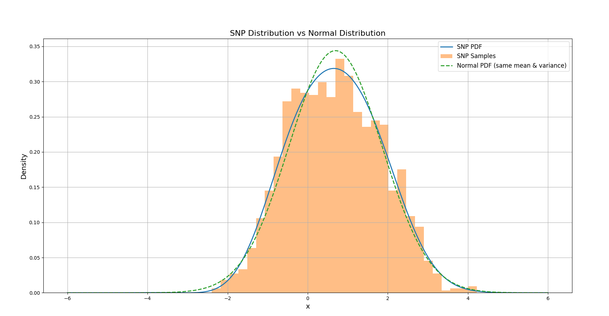
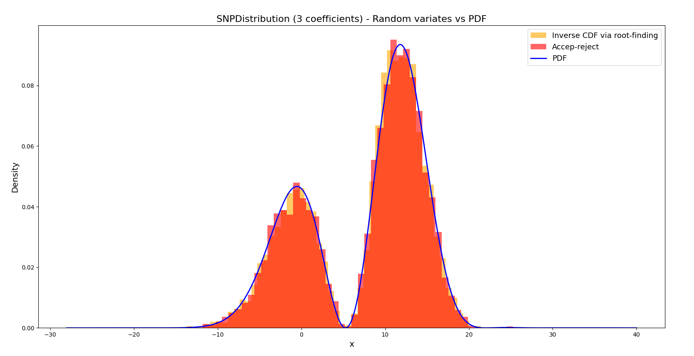
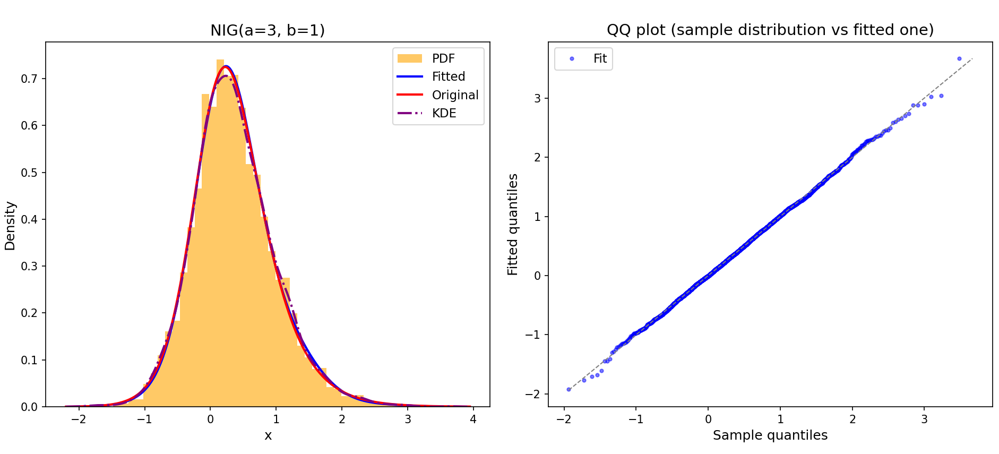
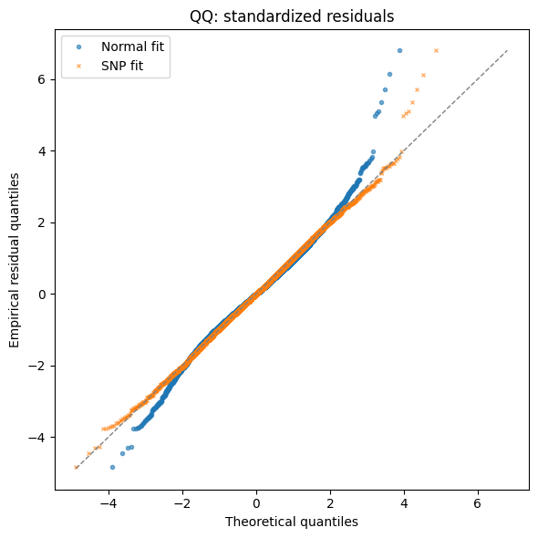

# SNP Density Estimation Package (snpdenspy)

[](https://www.python.org/)
[](https://pypi.org/project/snpdenspy/)
[](https://www.python.org/)

## Introduction

The `snpdenspy` package provides a Python implementation for the family of probability density functions known as semi-nonparametric (SNP). This family of densities arose from the seminal work in

- *Gallant & Nychka 1987, Semi-Nonparametric Maximum Likelihood Estimation*.

and the implementation of this package is mainly based on 

- *Gallant & Tauchen 1990, A nonparametric approach to nonlinear time series analysis: estimation and simulation*. 

The package implements the theoretical framework suggested in the paper. It offers efficient computational tools for density estimation, fitting, and sampling from SNP distributions, which are a powerful alternative to other nonparametric approaches (i.e. KDE), as well as to provide an easy way to integrate these densities into more complex models, such as a time series one.

## SNP Distributions' key benefits

SNP distributions offer several key benefits:

- **Nonparametric flexible approach**: Allow for general and rich density shapes, without overfitting when the polynomial degree is low.
- **Analytical tractability**: Closed-form expressions for PDF, CDF, and moments.
- **Computational Efficiency**: Fast evaluation and sampling compared to fully nonparametric methods.
- **Interpretability**: The set of coefficients can be easily transformed to the to ones defining the Edgeworth-Sargan family of densities, whose coefficients have a clear statistical interpretations related to density deviations from normality.
- **Integration**: Seamless integration with SciPy's ecosystem (specially `SNPSimpleDistribution`)

## Mathematical Formulation

The SNP density of a variable $`X`$ is formulated as an expansion of the standard normal density using probabilistic Hermite polynomials. For the standardized variable $`Z=\frac{X-\mu}{\sigma}`$, the Probability Density Function (PDF) is given by:

$$
f_Z(z) = \frac{\phi(z) \left(1 + \sum_{k=1}^{K} c_k H_k(z)\right)^2}{C}
$$

where:
- $` \mu`$ and $` \sigma`$ are the location and scale parameters
- $` \phi(z) `$ is the standard normal density
- $` H_k(z) `$ are the probabilistic Hermite polynomials (orthogonal with respect to $` \phi(z) `$)
- $` c_k `$ are unconstrained real-valued coefficients
- $` C `$ is the normalizing constant that ensures the density integrates to 1. Its value is (see section *Probabilistic Hermite polynomials* below for more details) 

$$ 
C = 1 + \sum_{k=1}^{K} c_k^2 k! 
$$

The Cumulative Density Function (CDF) of $`Z`$ is then

$$
F_Z(z) = \Phi(z) - \frac{\phi(z)}{d_0} \sum_{n=1}^{2K} d_n H_{n-1}(z)
$$

where $`\Phi(z)`$ is the cumulative distribution of the standardard normal and $d_0, ..., d_{2K}$ are the Hermite coefficients of the Edgeworth expansion of $\left(1 + \sum_{k=1}^{K} c_k H_k(z)\right)^2$. That is,

$$
\left(1 + \sum_{k=1}^{K} c_k H_k(z)\right)^2 = \sum_{n=0}^{2K} d_n H_{n}(z)
$$

Note that by imposing $d_1 = d_2 = 0$ then the denstity has zero mean and unit variance. See *Alan Stuart & Keith Ord, Kendall's advanced theory of Statistics, Volume 1 Distribution Theory* for more details.

Likewise, the $k$-th raw moment of the distribution is 

$$
E[Z^k] = \frac{1}{d_0}\sum_{n=0}^{2K} d_n E_\phi[Z^k H_n(Z)]
$$

where $E_\phi[Z^k H_n(Z)]$ is the expectation under the standard normal distribution. This can be computed using the monomial expansion of the Hermite polynomial

$$
H_n(z) = \sum_{j=0}^{\lfloor n/2 \rfloor} \frac{(-1)^j n!}{j! (n-2j)! 2^j} z^{n-2j}
$$

Thus,

$$
E_\phi[Z^k H_n(Z)] = \sum_{j=0}^{\lfloor n/2 \rfloor} \frac{(-1)^j n!}{j! (n-2j)! 2^j} E_\phi[Z^{k + n - 2j}]
$$

where $E_\phi[Z^m] = 0$ if $m$ is odd, and $E_\phi[Z^m] = (m-1)!!$ if $m$ is even (double factorial). Note however that the moment-matching fitting approach implemented in `SNPDistribution.fit_moment_matching()` uses a more efficient way of computing $E_\phi[Z^k H_n(Z)]$, as described in section *Moment Matching* below.

Now for the original variable $X$, the SNP functions are obtained from the standardized functions by the usual location-scale transform. That is,

$$
f_X(x) = \frac{1}{\sigma} f_Z\left(z\right)
$$

$$
F_X(x) = F_Z\left(z\right)
$$

and the raw moments of $X$ follow from the standardized moments of $Z$ via

$$
E[X^r] = \sum_{j=0}^{r} \binom{r}{j} \mu^{r-j} \sigma^j E[Z^j].
$$

The formulation herein explained allows for flexible density shapes while maintaining analytical tractability and providing efficient evaluation of PDF, CDF and moments functions.

## Probabilistic Hermite polynomials

The probabilistic Hermite polynomials are defined from the $n$-th derivative of the standard normal density:

$$
H_n(z) = (-1)^n \frac{1}{\phi(z)} \frac{d^n}{dz^n} \phi(z) = (-1)^n e^{z^2/2} \frac{d^n}{dz^n} e^{-z^2/2}
$$

For example, the first four probabilistic Hermite polynomials are:

$$
\begin{aligned}
H_0(z) &= 1, \\
H_1(z) &= z, \\
H_2(z) &= z^2 - 1, \\
H_3(z) &= z^3 - 3z.
\end{aligned}
$$

The probabilistic Hermite polynomials satisfy the orthogonality property:

$$
\int_{-\infty}^{\infty} H_m(z) H_n(z) \phi(z) \, dz = \delta_{mn} n!
$$

where $` \delta_{mn} `$ is 1 if m = n and 0 otherwise.

Thus, the integration constant $` C `$ in *Mathematical Formulation* section above

$$
C = \int_{-\infty}^{\infty} \phi(z) \left(1 + \sum_{k=1}^{K} c_k H_k(z)\right)^2 dz
$$

is calculated by expanding the square and using the orthogonality property:

$$
C = \int_{-\infty}^{\infty} \phi(z) dz + 2 \sum_{k=1}^{K} c_k \int_{-\infty}^{\infty} \phi(z) H_k(z) dz + \sum_{k=1}^{K} \sum_{m=1}^{K} c_k c_m \int_{-\infty}^{\infty} \phi(z) H_k(z) H_m(z) dz
$$

The first term is 1, the second term is 0 (since $` H_k(z) `$ are orthogonal to the constant function), and the third term is $` \sum_{k=1}^{K} c_k^2 k! `$. Thus:

$$
C = 1 + \sum_{k=1}^{K} c_k^2 k!
$$

## SNPSimpleDistribution

This class inherits from `scipy.stats.rv_continuous`, providing seamless integration with SciPy's statistical distributions framework. It supports exactly 5 Hermite coefficients ($` c_1 `$ to $` c_5 `$) and implements standard methods like `_pdf`, 
`_cdf`, `_ppf`, `_logpdf`, `_munp` and `_rvs`. However, it does not include overriden fitting algorithms, so its `fit` method rely on `rv_continuous` implementation. `_ppf` implementation relies on the `_cdf` implementation and a root-finding algorithm.

Key features:
- Inherits from `rv_continuous` for compatibility
- Fixed to 5 coefficients
- Efficient sampling via accept-reject method
- No fitting capabilities (use `SNPDistribution` for fitting)

### Basic Usage of SNPSimpleDistribution

This code ilustrates the use of the class SNPSimpleDistribution and its methods to analytically evaluate the density and calculate the mean and variance of the distribution. It also ilustrates the use of the rvs() method to sample random numbers from the SNP distribution.

```python
import numpy as np
import matplotlib.pyplot as plt
from scipy.stats import norm

from snpdenspy.snp.snp_rv_continuous import SNPSimpleDistribution

# Create distribution with 5 coefficients
dist = SNPSimpleDistribution()
c_params = [0.3, 0.1, 0.05, 0.0, 0.0]

# Evaluate PDF
x = np.linspace(-6, 6, 500)
pdf_vals = dist.pdf(x, *c_params, loc=0, scale=1)

# Generate samples
samples = dist.rvs(*c_params, size=1500, random_state=42)

# Compute mean and variance of the SNP distribution
mean_snp = dist.mean(*c_params, loc=0, scale=1)
var_snp = dist.var(*c_params, loc=0, scale=1)

# Evaluate normal distribution with same mean and variance
normal_pdf = norm.pdf(x, loc=mean_snp, scale=np.sqrt(var_snp))

# Plot the PDF, histogram of samples, and normal distribution
plt.figure(figsize=(10, 6))
plt.plot(x, pdf_vals, label='SNP PDF', linewidth=2)
plt.hist(samples, bins=30, density=True, alpha=0.5, label='SNP Samples')
plt.plot(x, normal_pdf, label='Normal PDF (same mean & variance)', linestyle='--', linewidth=2)
plt.xlabel('x', fontsize=14)
plt.ylabel('Density', fontsize=14)
plt.title('SNP Distribution vs Normal Distribution', fontsize=16)
plt.legend(fontsize=12)
plt.grid(True)
plt.show()
```
The code generates the following plot:



## SNPDistribution

This is the general implementation, supporting an arbitrary number of Hermite coefficients. It does not inherit from `rv_continuous` but provides similar functionality through methods like `pdf`, `cdf`, `ppf`, `logpdf`, `munp` and `rvs`. It includes both moment-matching and maximum likelihood estimation (MLE) fitting methods.

Key features:
- Arbitrary number of coefficients ($` K `$).
- Moment-matching and MLE fittings.
- Flexible parameter estimation options appropiated for time series analysis.
- Frozen distribution instances via `freeze()` method.

## Sampling Method

The package implements an efficient accept-reject sampling algorithm for generating random variates from SNP distributions described in the cited paper from Gallant & Tauchen 1990. The method uses a mixture of chi-squared distributions as the envelope, which is computationally superior to sampling via inverse CDF (root-finding on the CDF function) and particularly efficient for SNP distributions with moderate to high number of coefficients.

The sampling method is implemented for both `SNPSimpleDistribution` and `SNPDistribution`. The following code shows a usage example of the method highlighting its superior performance versus inverting the CDF via root-finding.

```python
import numpy as np
import matplotlib.pyplot as plt
from scipy.stats import norm

import matplotlib.pyplot as plt
import numpy as np
import time

from snpdenspy.snp.snp_distribution import SNPDistribution
from snpdenspy.util.diagnose.equal_distribution_plots import (
    qqplot_with_bootstrap_bands,
    ecdfs_with_bands
)

snp_dist = SNPDistribution(K=5)

# Example coefficients to create a bimodal shape
c_arr = [0.5, -0.8, 0.2, 0.0, 0.0]
loc, scale = 12, 5
frozen_dist = snp_dist(c=c_arr, loc=loc, scale=scale)

# Simulate random variates and plot histogram ---
nsamples = 5000
    
start_time = time.time()
samples_inv_cdf = frozen_dist.rvs(size=nsamples, method="icdf")
end_time = time.time()
elapsed = (end_time - start_time) / 60
print(f"Time taken to generate {nsamples} samples via root-finding: {elapsed:.4f} minutes")

start_time = time.time()
samples_accept_reject = frozen_dist.rvs(size=nsamples, method="ar")
end_time = time.time()
elapsed = (end_time - start_time) / 60
print(f"Time taken to generate {nsamples} samples via accept-reject: {elapsed:.4f} minutes")

# Evaluate PDF on a grid and plot histogram ---
xs = np.linspace(-28, 40, 500)
pdf_vals = frozen_dist.pdf(xs)

plt.figure(figsize=(8,4))
plt.hist(samples_inv_cdf, bins=50, density=True, alpha=0.6, color="orange", label="Inverse CDF via root-finding")
plt.hist(samples_accept_reject, bins=50, density=True, alpha=0.6, color="red", label="Accep-reject")
plt.plot(xs, pdf_vals, label="PDF", color="blue", lw=2)
plt.title("SNPDistribution (3 coefficients) - Random variates vs PDF", fontsize=16)
plt.xlabel("x", fontsize=14)
plt.ylabel("Density", fontsize=14)
plt.legend(fontsize=13)
plt.show()
```
The result of the execution of the code is: 
```python
Time taken to generate 5000 samples via root-finding: 0.3521 minutes
Time taken to generate 5000 samples via accept-reject: 0.0481 minutes
```


 
## Fitting Methods

### Moment-Matching

This method estimates the parameters by matching the empirical moments to the theoretical moments of the SNP distribution.

The theoretical moments of the SNP Distribution are described in section *Mathematical Formulation* above. To accelerate the estimation, we precompute the Gaussian-weighted Hermite expectations

$$
A_{r,n}:=E_\phi[Z^rH_n(Z)],\qquad Z\sim N(0,1).
$$

which depends only on $` r `$ and $` n `$, not on the data or SNP parameters. So Using $` zH_n(z)=H_{n+1}(z)+nH_{n-1}(z) `$, its entries satisfy

$$
A_{r,n}=A_{r-1,n+1}+nA_{r-1,n-1},
$$

with $` A_{0,0}=1 `$, $` A_{0,n}=0 `$ for $` n>0 `$, and $` A_{r,0}=A_{r-1,1}`$.

The table is therefore computed once before optimisation and reused at every iteration. During optimisation, only the coefficients \(d_n\) change.

The following code ilustrates the use of the method `fit_moment_matching` over a sample of points generated from a Normal Inverse Gaussian. The option `fit_loc_scale` controls whether the mean and variance are optimized or the data is normalized.

```python
import numpy as np
from scipy import stats

from snpdenspy.snp.snp_distribution import SNPDistribution
from snpdenspy.util.diagnose.diagnose_fit import diagnose_fit

nig_dist = stats.norminvgauss(a=3.0, b=1.0, loc=0.0, scale=1.0)
x = nig_dist.rvs(size=4000, random_state=np.random.default_rng(98))
        
snp = SNPDistribution(K=6)
c_hat, loc_hat, scale_hat = snp.fit_moment_matching(x=x, fit_loc_scale=True)        
fitted_dist = snp.freeze(c=c_hat, loc=loc_hat, scale=scale_hat)
print(f"\n=== NIG(a=3, b=1) ===")
diagnose_fit(
    x=x,
    fitted_dist=fitted_dist,
    pdf_original_func=nig_dist.pdf,
    title="NIG(a=3, b=1)",
    compare_normal=False,
    compare_kde=True)
```

It also ilustrates the use of the function `diagnose_fit`, which provides some goodness-of-fit statistics as the (KS) or Cramér-von Mises (CVM) and analisis of the input empirical distribution versus the fitted one. It also plots the histogram of the input data together with the fitted density, and optionally with the density used to generate the data (`pdf_original_func`) and the fit provided by `stats.gaussian_kde` (which uses the Silverman's rule for the bandwidth). 

The output of the previous code is as below.

```python
=== NIG(a=3, b=1) ===

--- Fit summary ---
Fitted parameters:
c=[-0.355 0.148 0.009 0.000 -0.000 0.001] loc=0.7894 scale=0.5534
Log-likelihood:    -3680.3177
Two-sample statistics vs fitted draws (empirical vs fitted):
  KS=  0.0076  CVM=  0.0000
Moment order  Empirical raw moment  Fitted raw moment
----------------------------------------------------------
 1              0.3632        0.3632
 2              0.5176        0.5176
 3              0.5888        0.5888
 4              1.0885        1.0885
 5              1.9899        1.9899
    q    Empirical       Fitted
------------------------------------
  1%      -0.9340      -0.9640
  5%      -0.5762      -0.5594
 10%      -0.3580      -0.3638
 25%      -0.0466      -0.0472
 50%       0.3120       0.3128
 75%       0.7292       0.7186
 90%       1.1688       1.1686
 95%       1.4537       1.4715
 99%       2.1226       2.0723
```



### Maximum Likelihood Estimation (MLE)

This other fitting algortihm implements the Maximum Likelihood Approach suggested by Gallant-Nychka. It maximizes the log-likelihood function with respect to the coefficients, location, and scale parameters.

Key options:
- `fit_loc` and `fit_scale`: Control whether to estimate location and scale parameters
- `constrain_std_moments`: Apply constraints to ensure zero mean and unit variance (different than zero location and unit scale!).
- `loc_scale_fn`: Allow fitting using externally provided mean and variance functions (useful for time series analysis)
- `loc_scale_params0`, `loc_scale_bounds`: Initial values and bounds for external parameters

The following code ilustrates the use of the advanced features of the method `fit_mle` over a sample of points generated from AR(1) time series with Student-t innovations.

```python
import numpy as np
import matplotlib.pyplot as plt
from scipy import stats
from scipy.stats import t

from snpdenspy.snp.snp_distribution import SNPDistribution
from snpdenspy.util.diagnose.diagnose_fit import diagnose_fit

# Parameters
phi = 0.7
sigma = 0.2
nsamples = 10000

# Generate standardized Student-t(7) innovations
np.random.seed(42)
noise = t.rvs(df=7, size=nsamples)
noise = (noise - noise.mean()) / noise.std(ddof=1)

# Simulate the AR(1) series with disturbance sigma * noise
x = np.zeros(shape=noise.shape)
x[0] = noise[0]
for i in range(1, len(x)):
    x[i] = phi * x[i - 1] + sigma * noise[i]

def ar1_loc_scale(theta, x):
    phi, log_sigma = theta
    y = np.asarray(x)
    loc = phi * np.concatenate([[0.0], y[:-1]])
    scale = np.exp(log_sigma)
    return loc, scale


def ar1_gaussian_mle(x):
    """
    MLE for AR(1) with Gaussian noise and zero intercept.
    """
    y = np.asarray(x, dtype=float)
    x_lag = y[:-1]
    x_curr = y[1:]
    denom = float(np.dot(x_lag, x_lag))
    if denom == 0.0:
        raise ValueError("Cannot estimate AR(1) when lagged values are all zero.")
    phi_hat = float(np.dot(x_curr, x_lag) / denom)
    resid = x_curr - phi_hat * x_lag
    sigma_hat = float(np.sqrt(np.mean(resid ** 2)))
    return phi_hat, sigma_hat

# Normal fit
phi_norm, sigma_norm = ar1_gaussian_mle(x)
print(f"Normal-noise AR(1) MLE: phi={phi_norm:.4f}, sigma={sigma_norm:.4f}")

# SNP fit
K = 6
dist = SNPDistribution(K=K)
theta0 = np.array([0.1, np.log(np.std(x, ddof=1))])

res = dist.fit_mle(
    x=x,
    fit_loc=False, fit_scale=False,          # loc/scale driven by model
    loc_scale_fn=ar1_loc_scale,
    constrain_std_moments=True,
    loc_scale_params0=theta0,
    return_opt_result=True,
    method="L-BFGS-B",
)
c_hat = res["c"]
theta_hat = res["external_params"]
phi_snp, sigma_snp = theta_hat[0], np.exp(theta_hat[1])
loc_hat, scale_hat = res["loc"], res["scale"]
print(f"SNP-noise AR(1) MLE: phi={phi_snp:.4f}, sigma={sigma_snp:.4f}")
```

which it will display:

```python
Normal-noise AR(1) MLE: phi=0.6947, sigma=0.2000
SNP-noise AR(1) MLE: phi=0.6943, sigma=0.2001
```

The following plot allows to visualize the two fits togheter, highlighting the additional accuracy on the tails provided by the SNP fit.

```python
# QQ plots for residuals vs assumed Normal and fitted SNP noise
eps_norm = (x[1:] - phi_norm * x[:-1]) / sigma_norm
eps_snp = (x[1:] - phi_snp * x[:-1]) / sigma_snp

probs = (np.arange(1, len(eps_norm) + 1) - 0.5) / len(eps_norm)
emp_norm = np.sort(eps_norm)
emp_snp = np.sort(eps_snp)

q_norm = stats.norm.ppf(probs)
q_snp = SNPDistribution(K=K)(c=c_hat).ppf(probs)
fig, ax = plt.subplots(figsize=(6, 6))
ax.plot(q_norm, emp_norm, "o", markersize=3, alpha=0.6, label="Normal fit")
ax.plot(q_snp, emp_snp, "x", markersize=3, alpha=0.6, label="SNP fit")
q_min = min(q_norm.min(), emp_norm.min(), q_snp.min(), emp_snp.min())
q_max = max(q_norm.max(), emp_norm.max(), q_snp.max(), emp_snp.max())
ax.plot([q_min, q_max], [q_min, q_max], "--", color="gray", linewidth=1)
ax.set_title("QQ: standardized residuals")
ax.set_xlabel("Theoretical quantiles")
ax.set_ylabel("Empirical residual quantiles")
ax.legend()

fig.tight_layout()
plt.show()
```



Please check the [notebooks](notebooks/) and [examples](examples/) for more examples.

Enjoy!


